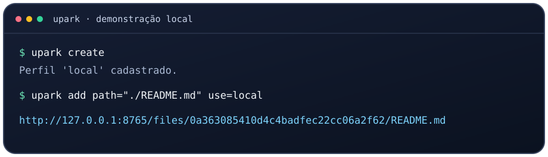

<div align="center">

# Upark

**Turn a local file into a shareable link from your terminal.**


[](LICENSE)

[Português](README.md) · **English**

[Install](#install) · [Try it locally](#try-it-without-an-account) · [Get a public link](#get-a-public-link-with-supabase) · [Automation](#automation-for-agents-and-ci) · [Providers](#providers)

</div>



Run `upark create` once per storage destination. Then publish files with `upark add path=FILE use=PROFILE`. You control where your files are stored and can keep separate profiles for different projects.

## Install

Requires **Python 3.11 or later**. Clone the repository and open the project directory.

```sh
git clone https://github.com/GustavoDiego/Upark.git
cd Upark
```

<details open>
<summary><b>Windows · PowerShell</b></summary>

```powershell
py -m venv .venv
.\.venv\Scripts\python.exe -m pip install .
.\.venv\Scripts\upark.exe --help
```

Use `.\.venv\Scripts\upark.exe` in the examples below, or activate the environment with `.\.venv\Scripts\Activate.ps1` and run `upark`. Use `python` if the `py` launcher is unavailable.

</details>

<details>
<summary><b>Linux · Bash</b></summary>

```bash
python3 -m venv .venv
source .venv/bin/activate
python -m pip install .
upark --help
```

</details>

Supabase, GitHub Releases, and SQLite also work without installing dependencies. Run `python -m upark` from the project directory.

## Try it without an account

1. Run `upark create`. Enter **local**, choose **4 — SQLite**, and accept the defaults.
2. Start the download server in your first terminal.

   ```sh
   upark serve use=local
   ```

3. In a second terminal, upload this README and open the URL printed by Upark.

   ```sh
   upark add path="./README.en.md" use=local
   ```

SQLite stores the file as a BLOB and supports files up to **256 MiB**. The default address, `http://127.0.0.1:8765`, works on your own computer while the server is running.

## Get a public link with Supabase

**Supabase Free** includes **1 GB of file storage** and supports files up to **50 MB**. Free projects may pause after a week of inactivity. [Pricing](https://supabase.com/pricing) · [Upload limits](https://supabase.com/docs/guides/storage/uploads/file-limits)

1. Create a project in the [Supabase Dashboard](https://supabase.com/dashboard). Under **Storage**, create a bucket named **upark-public** and enable **Public bucket**.
2. Copy the project URL, in the form `https://PROJECT_REF.supabase.co`. In **Settings → API Keys**, copy a **Secret** key that starts with `sb_secret_`. [API key documentation](https://supabase.com/docs/guides/getting-started/api-keys)
3. Run `upark create`, name the profile **my-supabase**, and choose **1 — Supabase Storage**. Enter the project URL, bucket, and key. The terminal hides the key as you type it.
4. Upload a file and open the URL in a private browser window.

   ```sh
   upark add path="./README.en.md" use=my-supabase
   ```

Each upload gets its own identifier, so files with the same name get separate links.

## Automation for agents and CI

Pass arguments to `upark create` to set up a profile without prompts. Use `--set` for destination settings and `--secret-env` to specify an environment variable by **name**. The profile stores the variable name and reads its value at upload time.

**Live example.** GitHub Actions published a sample through Upark, downloaded it anonymously, and compared it byte for byte with the original. [Download the sample](https://github.com/GustavoDiego/Upark/releases/download/demo-automacao/ed898ddce8c449ea92107b683737f430-upark-agent-demo.txt) · [View the workflow run](https://github.com/GustavoDiego/Upark/actions/runs/45861781905)

```bash
upark create --name demo --provider github \
  --set repository=OWNER/REPOSITORY --set tag=RELEASE_TAG \
  --secret-env token=GH_TOKEN

url=$(upark add --path "my-file.txt" --use demo)
printf '%s\n' "$url"
```

Use your own public repository and the tag of a published release that accepts additional assets. Set `GH_TOKEN` to a token with **Contents** write permission for that repository. Workflows in the same repository can use the temporary GitHub Actions token with `contents: write`. [Example workflow](.github/workflows/agent-demo.yml)

| `--provider` | `--set` fields | `--secret-env` fields |
| --- | --- | --- |
| `github` | `repository`, `tag` | `token` |
| `supabase` | `project_url`, `bucket` | `api_key` |
| `r2` | `endpoint`, `bucket`, `public_url` | `access_key`, `secret_key` |
| `s3` | `bucket`, `public_url`. Optional `endpoint`, `region` | `access_key`, `secret_key`. Optional `session_token` |
| `sqlite` | Optional `database`, `public_url` | None |

On success, `upark add` prints only the URL to standard output. A failed upload exits with a nonzero status. Scripts can pass the URL to documentation, comments, or another integration.

## Providers

| Option | Provider | Required setup | URL availability |
| :---: | --- | --- | --- |
| **1** | **Supabase Storage** | Project URL, public bucket, and secret key | Internet |
| **2** | **Cloudflare R2** | S3 endpoint, bucket, R2 credentials, and public URL | Internet |
| **3** | **Amazon S3 / S3-compatible storage** | Region, bucket, credentials, and public URL. Custom endpoint as needed | Internet |
| **4** | **SQLite** | Database path and download base URL | Local by default. Internet access requires a reachable server |
| **5** | **GitHub Releases** | Public repository, published release tag, and token with Contents write permission | Internet |

<details>
<summary><b>Configure Cloudflare R2 or S3</b></summary>

Install S3 support with `python -m pip install ".[s3]"`.

- **R2.** Use the account's S3 endpoint and credentials with write access to the bucket. For testing, enable the `r2.dev` public development URL. You can also connect a custom domain. [R2 credentials](https://developers.cloudflare.com/r2/api/tokens/) · [Public buckets](https://developers.cloudflare.com/r2/buckets/public-buckets/)
- **AWS.** Leave the endpoint blank, enter the region, and provide a public URL that can serve objects from the bucket, such as a CloudFront distribution configured for the bucket. Temporary AWS credentials also require a session token.
- **S3-compatible storage.** Enter the service's endpoint and region. Upark uses path-style addressing with custom endpoints.

Upark uses the permissions configured by the provider. After an upload, it checks the URL with an anonymous request. If that request fails, Upark reports the object key and expected URL so you can adjust public access or remove the object in the provider dashboard.

</details>

<details>
<summary><b>Serve SQLite over the internet</b></summary>

Run `upark serve use=PROFILE` on a reachable host. Point an HTTPS reverse proxy at `/files/` on the service's local port and use the external HTTPS address as the profile's base URL. If that address contains a path prefix, configure the proxy to strip it before forwarding. Use `--port` to change the local port.

</details>

## Commands

| Command | Purpose |
| --- | --- |
| `upark create` | Save a storage profile |
| `upark list` | List the configured profiles |
| `upark add path=FILE use=PROFILE` | Upload a file and print its URL |
| `upark serve use=PROFILE` | Start the download server for a SQLite profile |

Quote paths containing spaces, as in `upark add path="C:\Files\My file.pdf" use=my-supabase`. You can also use `--path "FILE" --use PROFILE`. If a profile is unknown, Upark reports the error and lists the available profiles.

> [!IMPORTANT]
> Anyone with the public URL can download the file. Interactive setup saves credentials as readable text in the local `profiles.sqlite3` database. Keep this file out of shared folders and repositories. In automation, use `--secret-env` to store only the environment variable name.

The default profile directory is `%LOCALAPPDATA%\upark` on Windows. On Linux, it is `$XDG_CONFIG_HOME/upark` or `~/.config/upark`. Set `UPARK_HOME` to use a different directory.

## Development and contributions

```sh
python -m pip install ".[s3]"
python -m unittest discover -s tests -v
```

Tests use temporary files, a mock Supabase API, and a local HTTP server for the S3 SDK integration. GitHub Actions runs the suite on Windows and Linux using Python 3.11 and 3.13.

When adding a provider, document its setup and download URL format, and include a test covering both upload and public access verification. When filing an issue, include your OS, Python version, provider, and command. Remove credentials from the report.

Released under the [MIT license](LICENSE).
