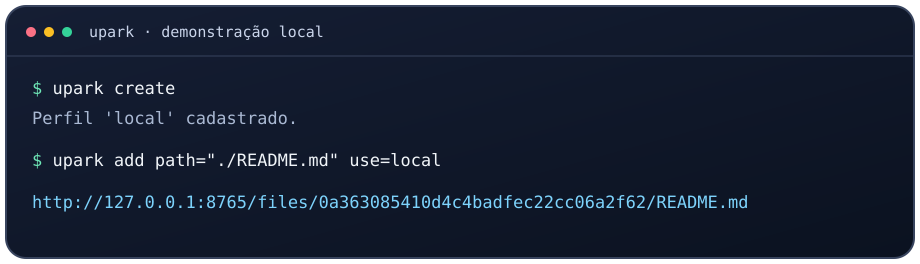

<div align="center">

# Upark

**Transforme um arquivo local em um link compartilhável, direto do terminal.**


[](LICENSE)

[Instalação](#instalação) · [Teste sem conta](#teste-sem-conta) · [Link público grátis](#link-público-grátis) · [Provedores](#provedores)

</div>



Cadastre seu destino uma vez com `upark create`. Depois, use o nome do perfil para publicar qualquer arquivo com `upark add path=CAMINHO use=PERFIL`. Você escolhe onde o arquivo fica e pode manter perfis diferentes para projetos diferentes.

## Instalação

Requer **Python 3.11+**. Na pasta do Upark, ative um ambiente virtual seguindo os comandos do seu sistema.

<details open>
<summary><b>Windows · PowerShell</b></summary>

```powershell
py -m venv .venv
.\.venv\Scripts\python.exe -m pip install .
.\.venv\Scripts\upark.exe --help
```

Use `.\.venv\Scripts\upark.exe` nos exemplos abaixo ou ative o ambiente com `.\.venv\Scripts\Activate.ps1` e use `upark`. Se o lançador `py` estiver ausente, substitua por `python`.

</details>

<details>
<summary><b>Linux · Bash</b></summary>

```bash
python3 -m venv .venv
source .venv/bin/activate
python -m pip install .
upark --help
```

</details>

Se você baixou o ZIP com o instalador, pode rodar `python -m pip install ./upark-0.1.0-py3-none-any.whl` dentro do ambiente virtual. Para experimentar Supabase ou SQLite sem instalar nada, use `python -m upark` a partir da pasta do projeto.

## Teste sem conta

1. Rode `upark create`. Digite **local**, selecione **4 — SQLite** e aceite os valores sugeridos.
2. No primeiro terminal, inicie o servidor.

   ```sh
   upark serve use=local
   ```

3. Em outro terminal, na pasta do projeto, publique o próprio README e abra no navegador o endereço devolvido.

   ```sh
   upark add path="./README.md" use=local
   ```

O arquivo fica no SQLite como BLOB, com limite de **256 MiB por arquivo**. O endereço padrão `http://127.0.0.1:8765` é acessível no próprio computador e depende do servidor em execução.

## Link público grátis

O **Supabase Free** inclui **1 GB de armazenamento**, com limite de **50 MB por arquivo**. Projetos gratuitos podem ser pausados após uma semana de inatividade. [Preços](https://supabase.com/pricing) · [Limites de upload](https://supabase.com/docs/guides/storage/uploads/file-limits)

1. No [Supabase Dashboard](https://supabase.com/dashboard), crie um projeto. Em **Storage**, crie o bucket **upark-publico** e marque **Public bucket**.
2. Copie a URL `https://REF_DO_PROJETO.supabase.co`. Em **Settings → API Keys**, copie a chave **Secret** que começa com `sb_secret_`. [Documentação de chaves](https://supabase.com/docs/guides/getting-started/api-keys)
3. Rode `upark create`, nomeie o perfil **meu-supabase** e escolha **1 — Supabase Storage**. Informe a URL, o bucket e a chave no terminal. A digitação da chave fica oculta.
4. Envie um arquivo e confira o link em uma janela anônima.

   ```sh
   upark add path="./README.md" use=meu-supabase
   ```

Cada envio recebe um identificador próprio. Você pode enviar arquivos de mesmo nome sem sobrescrever os anteriores.

## Provedores

| Opção | Destino | O que configurar | Onde o link abre |
| :---: | --- | --- | --- |
| **1** | **Supabase Storage** | URL do projeto, bucket público e chave Secret | Internet |
| **2** | **Cloudflare R2** | Endpoint S3, bucket, credenciais R2 e URL pública | Internet |
| **3** | **Amazon S3 / compatível** | Região, bucket, credenciais e URL pública. Endpoint opcional para AWS | Internet |
| **4** | **SQLite** | Arquivo de banco e URL base de download | Local por padrão, público com servidor acessível |

<details>
<summary><b>Configurar Cloudflare R2 ou S3</b></summary>

Instale o suporte adicional com `python -m pip install ".[s3]"`.

- **R2.** Copie o endpoint S3 da conta e crie um token com permissão de escrita no bucket. Habilite a URL pública de desenvolvimento `r2.dev` para testes ou use um domínio configurado no bucket. [Credenciais R2](https://developers.cloudflare.com/r2/api/tokens/) · [Acesso público](https://developers.cloudflare.com/r2/buckets/public-buckets/)
- **AWS.** Deixe o endpoint vazio, preencha a região e informe uma URL que permita leitura dos objetos, como uma distribuição CloudFront configurada para o bucket. Credenciais temporárias também precisam do token de sessão.
- **S3 compatível.** Informe o endpoint e a região esperada pelo serviço. Endpoints personalizados usam endereçamento por caminho.

O Upark usa as permissões configuradas no provedor. Depois do upload, ele testa o link com uma requisição anônima. Se a leitura falhar, o comando mostra a chave do objeto e a URL esperada para você ajustar a exposição ou remover o arquivo no painel do provedor.

</details>

<details>
<summary><b>Servir SQLite pela internet</b></summary>

Rode `upark serve use=PERFIL` em um host acessível e aponte um proxy reverso HTTPS para `/files/` na porta local do serviço. Cadastre o endereço HTTPS externo como URL base do perfil. Se usar um prefixo na URL, configure o proxy para removê-lo antes de encaminhar ao Upark. Você pode mudar a porta local com `--port`.

</details>

## Comandos

| Comando | O que faz |
| --- | --- |
| `upark create` | Cadastra um destino de upload |
| `upark list` | Lista os perfis disponíveis |
| `upark add path=ARQUIVO use=PERFIL` | Envia um arquivo e imprime o link |
| `upark serve use=PERFIL` | Inicia o servidor de downloads de um perfil SQLite |

Para caminhos com espaços, use aspas, como em `upark add path="C:\Arquivos\Meu arquivo.pdf" use=meu-supabase`. O comando também aceita `--path "CAMINHO" --use PERFIL`. A saída padrão contém só a URL em caso de sucesso, o que facilita capturá-la em scripts. Caminhos inexistentes e perfis desconhecidos retornam erro. No segundo caso, o Upark lista os perfis cadastrados.

> [!IMPORTANT]
> Qualquer pessoa com acesso ao link público pode baixar o arquivo. A chave do provedor fica em texto legível no banco local `profiles.sqlite3`. Mantenha esse banco fora de repositórios e pastas compartilhadas.

Por padrão, os perfis ficam em `%LOCALAPPDATA%\upark` no Windows e em `$XDG_CONFIG_HOME/upark` ou `~/.config/upark` no Linux. Defina `UPARK_HOME` para mudar o diretório.

## Desenvolvimento e contribuições

```sh
python -m pip install ".[s3]"
python -m unittest discover -s tests -v
```

A suíte usa arquivos temporários, uma API Supabase simulada e um servidor HTTP local para o teste com o SDK S3. A matriz do GitHub Actions cobre Windows e Linux com Python 3.11 e 3.13.

Para contribuir com um provedor, inclua as instruções de cadastro, o formato da URL de download e um teste que cubra o upload e a verificação de acesso. Para relatar um problema, informe a versão do Python, o sistema, o provedor e o comando usado, removendo suas credenciais.

Distribuído sob a [licença MIT](LICENSE).
